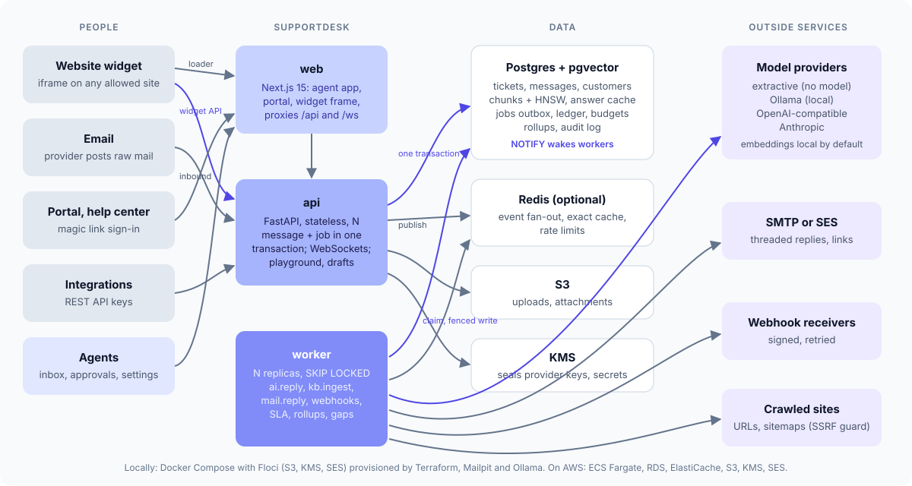
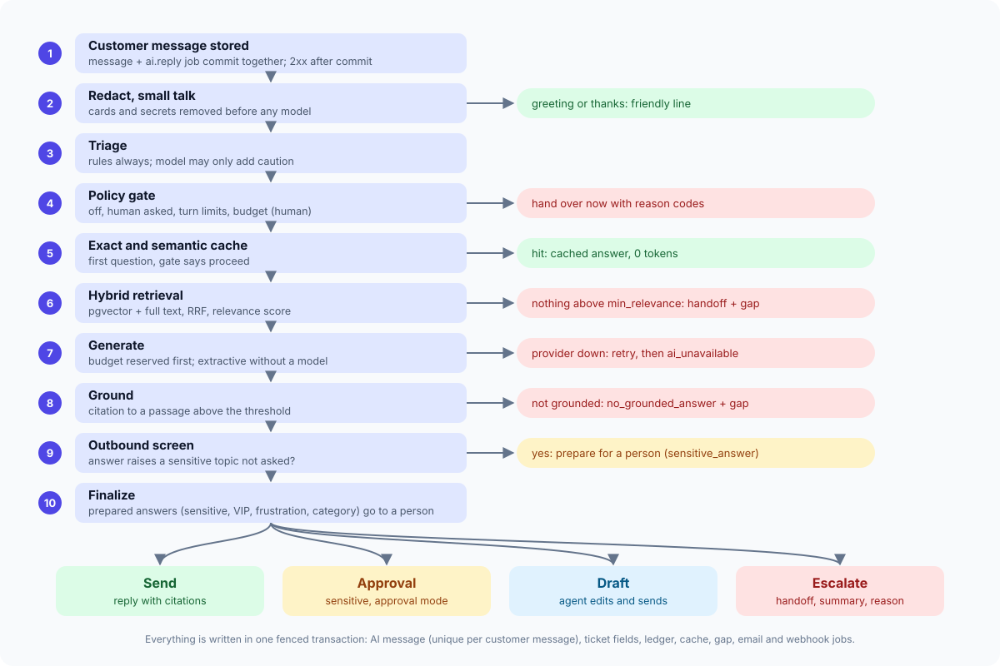

# High-level design

Euron Open SupportDesk is a self-hosted customer support platform. A company runs it on
its own servers, uploads its documentation, pastes one script tag into its website, and
gets a shared inbox where an AI support agent answers what it safely can from the
company's own knowledge and hands everything else to a person with the transcript, a
summary and the reason. Whether an AI answer may be sent is decided by deterministic code,
not by the model, and every model call lands in a ledger with its tokens and cost.

## Goals and non-goals

| Goals | Non-goals (0.1.0) |
| --- | --- |
| Never lose a customer message: a message accepted with 2xx is stored, and its AI turn is a job in the same transaction | WhatsApp, Messenger, Telegram, Slack, SMS and voice channels |
| AI answers only from the organisation's knowledge, with citations, and only when policy allows | AI actions through tools (look up an order, issue a refund) |
| Every conversation reaches an owner, the AI or a person, with a clear status and a reason when handed over | Visual automation rules, business hours in SLAs |
| Works with no API key at all (extractive answers, local embeddings) or a local Ollama model | SSO (OIDC, SAML), Kubernetes Helm chart |
| Visible token economics: ledger, hard budgets enforced before a call, cost per AI resolution | A hosted multi-tenant SaaS (it is multi-organisation, but you operate it) |

## Context

| Actor | Talks to | How |
| --- | --- | --- |
| Customer on the company website | Widget iframe served by `web`, which calls `api` directly | `POST /api/v1/widget/...`, WebSocket `/ws/widget/{ticket_id}` |
| Customer by email | The mail provider, which posts the raw message to `api` | `POST /api/v1/channels/email/inbound/{token}` (raw RFC 822, or SES through SNS) |
| Customer in the portal and help center | `web` pages under `/help/{slug}` | `/api/v1/portal/...`, `/api/v1/help/...`, WebSocket `/ws/portal/{ticket_id}` |
| Agent, admin, owner | `web` agent app | Cookie session, REST under `/api/v1`, WebSocket `/ws/agent` |
| Company backend (integration) | `api` | API key `sdk_...` with read or write scope; signed webhooks out |
| Company backend (identity) | Signs customer ids for identity verification | `HMAC-SHA256(identity secret, external_id)`, see [channels.md](channels.md) |
| Model providers | Called by `api` (playground, drafts) and `worker` (AI turns, ingestion) | Extractive (in process), Ollama, OpenAI-compatible, Anthropic |

## Components

| Component | What it does | Where |
| --- | --- | --- |
| Web app (`web`) | Next.js 15: agent app (inbox, approvals, customers, knowledge, gaps, analytics, settings), help center and portal, the widget frame page and the `widget.js` loader. Proxies `/api/*` and `/ws/*` to the API so the agent app has one origin and a cookie session. Sets the Content Security Policy, including the widget frame's `frame-ancestors` | `apps/web/` |
| API (`api`) | FastAPI. Every REST endpoint, the WebSocket hubs, the knowledge playground and AI drafts. Stateless | `apps/api/src/supportdesk/` (one package per domain), `supportdesk serve` |
| Worker (`worker`) | Claims jobs from the `jobs` table (AI turns, ingestion, outgoing email, webhooks) and runs periodic tasks (SLA scan, auto-resolve, gap clustering, analytics rollup, job pruning). Stateless, N replicas | `supportdesk/worker.py`, `core/jobs.py`, `core/tasks.py` |
| Postgres 16 + pgvector | Everything durable: organisations, settings, tickets, messages, customers, knowledge chunks with embeddings, the answer cache, the jobs table, the ledger, budgets, rollups, the audit log | RDS on AWS |
| Redis 7 (optional) | Live event fan-out between processes, the exact answer cache copy, rate-limit windows. Without it each process uses memory and Postgres `LISTEN/NOTIFY` | ElastiCache on AWS |
| Object storage | Uploaded knowledge files, email attachments, raw inbound mail (AWS), backups | Local disk or S3 (Floci locally) |
| KMS | Seals AI provider keys, webhook secrets and widget identity secrets (`KEY_MODE=kms`); a local AES-GCM key otherwise | KMS (Floci locally) |
| Mail | Ticket replies, portal sign-in links, invitations | `log`, SMTP (Mailpit locally) or SES |
| Model providers | Chat models and embedders behind two Protocols (`ChatModel`, `Embedder`) | `ai/providers/` |

One Python package holds the API, the worker, the CLI and the mock AI used by tests and
the demo; one image (`infra/docker/server.Dockerfile`) runs all of them with different
commands. The web app has its own image.

## A customer message, end to end

1. The widget posts `POST /api/v1/widget/messages` with its visitor token. The API checks
   the token, the inbox, the `Origin` and the rate limits, then in one transaction writes
   the ticket (if new), the customer message, an `ai.reply` job (dedupe key
   `ai:<message id>`), webhook deliveries and their jobs. `NOTIFY` fires on commit. Only
   then does the request return 201 with the conversation.
2. Live events (`message.created`, `ticket.updated`) are published after the commit to the
   organisation topic (agents) and the ticket topic (the customer's widget).
3. A worker woken by `NOTIFY` claims the job with `FOR UPDATE SKIP LOCKED` and a lease.
4. The AI engine runs: redaction, triage, the policy gate, the exact and semantic caches,
   hybrid retrieval, generation, grounding, outbound screening, the final decision. No
   transaction is held across model calls. See [ai-agent.md](ai-agent.md).
5. The outcome is written in one fenced transaction: the AI reply (unique per customer
   message), or a draft or pending approval plus a handoff, the ticket fields, ledger
   rows, the cache entry, a knowledge gap when nothing grounded was found, a
   `mail.reply` job when the customer has an email address, webhook deliveries. Events go out after commit.
6. The widget hears `message.created` on its socket and refetches the conversation over
   REST. Agents' inbox lists refresh the same way.

## Other flows

| Flow | Path |
| --- | --- |
| Knowledge upload | `POST /api/v1/knowledge/sources/upload` (admin) stores the file in object storage and enqueues `kb.ingest`; the worker parses, chunks and embeds outside any transaction, then swaps the chunks and bumps the organisation's `kb_version` in one fenced transaction ([knowledge.md](knowledge.md)) |
| Inbound email | The provider posts the raw message; the API authenticates the inbox by its inbound token hash, parses, threads (reply token, then `In-Reply-To`/`References`), and writes the message and its `ai.reply` job as above ([channels.md](channels.md)) |
| Agent reply | `POST /api/v1/tickets/{id}/messages` writes the reply, takes the conversation from the AI (`handled_by = human`), enqueues `mail.reply` when the customer has an email address (always on email tickets) and webhook deliveries |
| Approval | `POST /api/v1/messages/{id}/approve` turns a pending AI answer into a sent reply (optionally edited); `reject` discards it |
| Webhooks | One `webhook_deliveries` row and one `webhooks.deliver` job per subscribed webhook, written in the same transaction as the change |
| Periodic | `sla.scan` (60 s), `gaps.cluster` (60 s), `tickets.auto_resolve` (300 s), `analytics.rollup` (300 s), `jobs.prune` (3600 s), each under a Postgres advisory lock so one replica runs it |

## Caching layers

Every cache below has one owner, a key that includes everything its value depends on, and
an invalidation trigger. A cache outage is a miss, never an error.

| Layer | What | Where | Key | TTL | Invalidation trigger | Proven by |
| --- | --- | --- | --- | --- | --- | --- |
| Exact answer cache (fast path) | A grounded, model-generated answer that was sent, with its citations, tokens and cost | KV: Redis when `REDIS_URL` is set, otherwise an in-process LRU bounded by `MEMORY_CACHE_MAX_BYTES` | `sd:ac:{org_id}:{kb_version}:{sha256(normalised question)}`; normalisation lower-cases, drops punctuation and stopwords | `token_saver.cache_ttl_hours` (default 336 h) | Any knowledge change bumps `orgs.kb_version`, so old keys are never read again; a customer marking the answer unhelpful deletes the key | `test_every_call_is_in_the_ledger_and_a_repeat_comes_from_cache`, `test_changing_the_knowledge_invalidates_the_cache`, `test_deleting_a_source_removes_its_answers` (integration) |
| Exact answer cache (durable) | The same entry | Postgres `answer_cache`, unique `(org_id, kb_version, question_hash)` | as above | `token_saver.cache_ttl_hours` (lookups ignore older rows; `jobs.prune` deletes retired versions) | `kb_version` bump; `disabled = true` when a customer marks it unhelpful | same tests |
| Semantic answer cache | The nearest previous question's answer | Postgres `answer_cache.embedding`, HNSW expression index per dimension | `(org_id, kb_version, dims)` plus cosine similarity at or above `token_saver.semantic_threshold` (default 0.92) | `token_saver.cache_ttl_hours` | `kb_version` bump; `disabled` | same tests |
| Knowledge version | `orgs.kb_version` | Postgres | per organisation | n/a | Bumped in the same transaction as: a source's chunk swap, a source deletion, an article indexed, an article unpublished or deleted, and a change to the AI settings or the policy (answers made under the old model or rules are retired) | `test_reindex_replaces_chunks_atomically`, `test_published_articles_answer_and_unpublished_ones_do_not` |
| Embedding models | The fastembed ONNX model (loaded once per process); remote embedder clients keyed by `(embedder, base_url, model, dims, key)` | Process memory, model files in `MODEL_CACHE_DIR` | model name / config tuple | process lifetime | A changed embedder configuration builds a new client and schedules a re-index of every source | `test_settings_validate_and_seal_the_key` |
| Widget frame policy | The `frame-ancestors` list for a widget key | `web` middleware, in-process `Map` (500 entries, cleared when full) | widget public key | 60 s | TTL only: an allowed-origin change reaches each `web` replica within 60 s. An unreachable API or unknown key caches `'self'` (fails closed) | `apps/web/test/routing.test.ts` |
| React Query | Server state in the browser | TanStack Query | per feature query keys (`src/lib/query-keys.ts`) | `staleTime`: live 5 s (inbox lists, conversation), list 15 s, config 30 s (settings, inboxes, macros, analytics), static 5 min | WebSocket invalidations (`agentKeysFor` in `src/lib/live-events.ts`), mutations invalidate their keys, polling fallback while a socket is down | `apps/web/test/live-events.test.ts` |
| Analytics rollups | Daily counts, medians, tokens, cost, breakdowns | Postgres `stats_daily`, unique `(org_id, day)` | `(org_id, day)` | n/a | Recomputed for today and yesterday every 300 s; today is recomputed on every overview read; range percentiles are computed live, never from rollups ([analytics.md](analytics.md)) | `test_overview_matches_a_hand_computed_fixture` |
| HTTP | `widget.js`: `Cache-Control: public, max-age=300`; attachments: `private, no-store`; sign-in responses: `no-store` | Browser, any CDN | URL | as stated | Redeploy (the loader is small and stable) | n/a |
| Rate limits | Sliding-window counters (60 s) | KV (Redis Lua script, atomic; memory fixed windows without Redis) | `login:{ip}`, `signup:{ip}`, `accept:{ip}`, `wsess:{ip}`, `wmsg:{customer}`, `wmsg-ip:{ip}`, `plink:{ip}`, `plink-email:{email}`, `pmsg:{customer}` | 2 windows | Expire on their own | `tests/unit/core/test_kv.py` |

Things that are deliberately **not** cached: session revocations (a primary key lookup in
`revoked_sessions`, so eviction can never bring a signed-out session back), organisation
settings (read per request and per job, so a policy change applies to the next message),
and budget usage (a conditional `UPDATE` in Postgres is the only source of truth).

A knowledge change is the only thing that retires cached answers. Changing the policy
(for example `min_relevance`), the answer model or the categories does not, because the
cache holds only answers that were grounded and sent; turn the caches off in
Settings > Token Saver if you want every question regenerated.

No endpoint sets an `ETag`; lists are small keyset pages and live updates make
conditional requests unnecessary.

## Scaling

| What | How it scales |
| --- | --- |
| API | Stateless. Run N replicas behind the load balancer; WebSockets are fanned out by one Redis pattern subscription (or one Postgres `LISTEN` connection) per process, not one per socket |
| Worker | Stateless. N replicas each claim up to `WORKER_CONCURRENCY` jobs with `FOR UPDATE SKIP LOCKED`; leases (`JOB_LEASE_S`, extended every third of the lease by a heartbeat) let any replica reclaim a dead one's jobs. Periodic tasks run under advisory locks |
| Postgres | One query per list (keyset on `last_message_at, id`, previews with `DISTINCT ON`), indexes on every filter, HNSW per embedding size, pool sized by `DB_POOL_SIZE` and `DB_MAX_OVERFLOW` |
| Redis | Pub/sub and small keys only; nothing durable depends on it |
| Model calls | Bounded by `AI_TIMEOUT_S`, budgets reserved before each call, caches in front |

Throughput, measured by `make bench` on a 12-core laptop with the local embedder and the
mock model (raw results in `docs/bench.json`): retrieval 4.8 ms p50, an extractive answer
70 ms p50, the model path 100 ms p50 plus the model, an exact cache hit 63 ms p50, ingest
55 chunks per second, 55 messages accepted per second, one worker answering 8.8 turns per
second, WebSocket fan-out 8 ms p50.

## Failure modes

| Failure | What happens |
| --- | --- |
| Model provider timeout, 429 or 5xx | The `ai.reply` job is retried with backoff (2 s, 10 s) while attempts remain; on the last attempt, or for a non-retryable error, the conversation is handed to a person with `ai_unavailable`. Triage and summaries fall back to rules and a deterministic summary |
| Worker killed mid-job | Its lease expires after `JOB_LEASE_S`; another worker reclaims the job. The fenced write and the unique index on `(reply_to_id) WHERE author_type = 'ai'` make the reply appear once (`test_a_crashed_workers_job_is_reclaimed_and_answered_once`) |
| A job fails every attempt | It is marked `dead` with its last error; `ai.reply` has an `on_dead` handler that hands the conversation over, so the customer is never left unanswered |
| Redis down | Caches miss, rate limits pass (best effort), live events fail to publish (logged); jobs are unaffected because they live in Postgres. Readiness reports `degraded`, not failing |
| Postgres down | Readiness fails (503); the API refuses writes; workers keep retrying to connect |
| Embedding provider down | Retrieval continues with full-text search only (noted on the decision panel); ingestion retries, then marks the source `failed` with the reason |
| Mail backend refuses | `mail.reply` retries; after the last attempt the message's `delivery.email` is `failed` and the agent sees it |
| Webhook receiver failing | Retries with backoff up to 8 attempts; after 10 consecutive failures the webhook is switched off with the reason |
| Budget exhausted | Before the call is made: extractive answer or handoff with `budget_exhausted`, as the organisation chose; never an error to the customer |

## Deployment shapes

| Shape | How | Use |
| --- | --- | --- |
| Local, emulated AWS | `make up`: Compose with Floci provisioned by the same Terraform modules (S3, KMS, Secrets Manager, SES) | Development, evaluation, the demo |
| Local with a local model | `make ollama-pull` adds the `ollama` profile | Zero-API-key mode with an LLM ([zero-api-key.md](../guides/zero-api-key.md)) |
| Local against real AWS | `make up-aws` with `deploy/compose/.env.aws` | Testing S3, KMS and SES for real |
| AWS | `make aws-deploy`: ECS Fargate (api, worker, web) behind an ALB, RDS PostgreSQL with pgvector, ElastiCache, S3, KMS, Secrets Manager, SES, CloudWatch | Production ([deploy-aws.md](../guides/deploy-aws.md)) |

## Observability

Structured JSON logs with request ids (`X-Request-Id` in and out); Prometheus `/metrics` on
the API and on the worker (`WORKER_METRICS_PORT`, default 9464): AI decisions by action and
method, jobs by kind and result, job duration, open WebSockets by kind; `/healthz`,
`/readyz` (Postgres decides, Redis reported); `GET /api/v1/system` (admin) shows job queue
counts and live connections. Optional OpenTelemetry tracing (`OTEL_ENABLED`). On AWS,
CloudWatch alarms cover load balancer errors and latency, ECS tasks not running, RDS and
ElastiCache health, job failures and failed AI turns ([operations.md](../guides/operations.md)).
